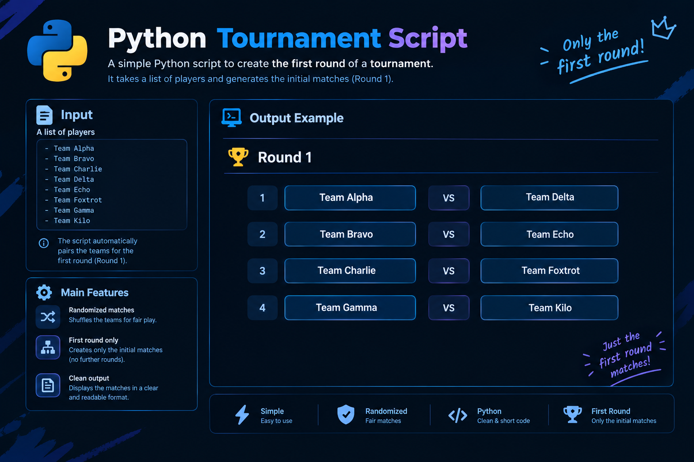

# Tournament Table Generator

A small Python script that reads a list of players from a text file, randomly pairs them into matches, saves the pairings as JSON, and prints them in a readable format after a passkey check.

## Features

- Loads players from a plain text file (one name per line)
- Randomly pairs players so nobody plays themselves or appears twice
- Saves the matches to a JSON file
- Prints the match list to the console once the correct passkey is entered
- Handles a missing or empty data file with a clear error message

## Requirements

- Python 3.6+
- No third-party packages (uses only `random`, `json`, and `os` from the standard library)

## Usage

1. Create a `data.txt` file in the same folder as the script, with one player name per line:

   ```
   Oussama
   Aimen
   Rabie
   Hrimat
   ...
   ```

2. Run the script:

   ```bash
   python3 tournament.py
   ```

3. The matches are saved to `done.json`, and the script prompts you:

   ```
   Sucessfully Matches Saved on: {'done.json'}
   To Print The Output Enter '1337':
   ```

4. Enter `1337` to display the matches.

## Example

**Input (`data.txt`):**

```
Oussama
Aimen
Rabie
Hrimat
...
```

**Saved output (`done.json`):**

```json
{
  "Match 1": ["Rabie", "Hrimat"],
  "Match 2": ["Oussama", "Aimen"]
}
```

**Console output after entering the passkey:**

```
Matches Output:

     | Rabie Vs Hrimat
     | Oussama Vs Aimen
```

Pairings are random, so your results will differ on each run.

## Configuration

The file paths are set at the bottom of the script:

```python
tournament = TournamentTable(data_path="data.txt", save_file="done.json")
```

Change `data_path` to read players from a different file, or `save_file` to write the matches elsewhere.

## How It Works

| Method | Purpose |
| --- | --- |
| `create_players()` | Reads the data file, skips blank lines, and stores each line as a player. Returns `0` on error. |
| `vs_players()` | Picks two random players from the remaining list. |
| `create_json_table()` | Checks the player count is even, then repeatedly draws pairs, removing both players from the pool until none are left. Writes the result to JSON and prompts for the passkey. |
| `format_json()` | Reads the saved JSON file and prints each match on its own line. |

## Notes and Limitations

- **Player count must be even.** If it is odd, the script prints `Players Must Be Even !` and nothing is saved.
- **Names must be unique.** Duplicate names can cause incorrect pairings, because players are removed by name.
- **Whitespace is not trimmed.** Make sure lines in `data.txt` have no stray leading or trailing spaces.
- **Output file is overwritten** every time the script runs.
- **Passkey:** the value `1337` is hardcoded in `create_json_table()`. Change it there if you want a different one.
- **Pressing Ctrl+C** at the passkey prompt clears the screen and prints a joke message.

## License

Free to use and modify.